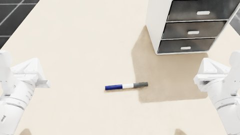

# 04 场景与专家轨迹

用第 2 章的物体和第 3 章的机器人搭一个场景，编写专家程序，然后分三步得到专家轨迹：构建场景（采样并检查初态）、生成轨迹、渲染录像。以[场景 000000](../../asset_sources/scenes/000000/) 为例：X1Pro 站在桌前，桌上一个三抽屉柜和一支笔；机器人打开最下层抽屉，把笔放进去，再关上。各文件的要求见[场景与专家轨迹规范](../designs/asset-pipeline/scenes.md)。



## 交付物

源码目录 `asset_sources/scenes/<编号>/`，由 AI 按规范编写，提交到 Git：

| 文件 | 作用 |
| --- | --- |
| `scene.py` | 场景：桌子、机器人及起始姿态、物体、录像视角，以及每个 seed 怎样随机摆放（`initialize`） |
| `expert.py` | 专家程序 `solve(ctx)`：按英文子任务组织的阻塞式代码，用运动原语、几何查询和抓取几何完成任务 |
| `thumbnail.jpg` | 场景的缩略图：最小有效 seed 的初态，机器人主相机图像，宽 480，由 `build_scene.py` 生成 |

生成的结果不进 Git，三步各自的产出与验收见下文，每个文件见[资产布局](../designs/asset-pipeline/README.md#资产布局)：

| 位置 | 来自 | 内容 |
| --- | --- | --- |
| `assets/scenes/<编号>/` | 第 1 步 | 场景的初态：每个 seed 静置后的状态、检查报告、初态图片 |
| `data/scenes/<编号>/<后端>/` | 第 2、3 步 | 一批专家轨迹及其报告、录像 |

**本例场景**：抽屉柜放在桌子右侧，位置 ±5 cm、偏航 ±15°；笔在机器人右手前方，位置 ±5 cm、朝向任意。专家分四个子任务：`open the bottom drawer of the cabinet`、`pick up the pen`、`put the pen into the drawer`、`close the drawer`。笔朝向任意，所以抓笔和放笔各有几种物理上等价的做法，按顺序尝试，见 [expert.py](../../asset_sources/scenes/000000/expert.py)。

三步的命令都分成 `--jobs` 个进程同时运行：seed 分成连续的段，第 3 步要渲染的轨迹按帧数分配，每个进程一份。本机运行时进程平均分到 `--gpus` 列出的显卡上，`--jobs` 默认每张卡一个；`--launcher PREFIX` 把每个进程交给作业调度器，由调度器选卡，例如 `--launcher "srun --gres=gpu:1"`，这时不给 `--gpus`，`--jobs` 默认 16。某个进程失败不影响其他进程；进程中途退出而没有留下结果的 seed 自动重跑，次数由 `--retries` 设置（默认 1），仍没有结果时脚本最后以非零退出码结束。每个进程启动约 20 s。批量运行用固定提交的独立检出，运行期间不改代码、场景和资产。

## 1. 构建场景

对每个 seed 运行 `scene.py` 的 `initialize` 采样摆放，检查无穿透，复位后静置 1 s 检查物体不动、机器人不碰任何东西；不通过就换子 seed 重新采样，最多 20 次。通过的初态存下来，第 2 步直接从这些状态开始。物理固定用 `isaac-cpu`。

```bash
uv run python scripts/scenes/build_scene.py 000000 --seeds 0:100 --gpus 0 1 2 3 --grid 5x5
```

- `--seeds` 接受区间和单个 seed，区间左闭右开：`0:100` 为 seed 0–99。
- 图片只在给出参数时渲染，否则只做检查：`--grid NxM` 把前 N × M 个有效初态拼成一张图；`--images` 为每个有效初态单独存一张相机原图。
- `--camera` 指定拍照的相机，默认是机器人的主相机（`robot.py` 中第一个 RGB 相机，X1Pro 为头部相机 `face_view`）；也可以写场景的固定视角，如 `wide`。
- 渲染图片时，用本次最小的有效 seed 更新 `asset_sources/scenes/<编号>/thumbnail.jpg`。
- `--output DIR` 指定输出根目录（默认 `assets/scenes`），结果写到 `DIR/<编号>/`；自定义输出时不更新缩略图。
- 每次运行整体替换输出目录中的初态。代码不变时同一 seed 的摆放相同，静置后的状态可能有微小差异；已生成的轨迹各自记录了起点，不受影响。换相机重新出图也是重跑这一步。

不渲染时 GPU 几乎不参与计算，每个进程约占 0.5 GB 显存和 5 个 CPU 核，`--jobs` 可以是显卡数的几倍；渲染时显存占用大，每张卡宜少。本例 100 个 seed，带 `--grid 5x5` 在 4 张卡上约 3 分钟：每个进程都会渲染本段的前 25 个有效初态，本例每段正好 25 个，所以全部渲染了。

**产出** `assets/scenes/<编号>/`：

| 文件 | 内容 |
| --- | --- |
| `initial_states.hdf5` | 每个有效 seed 一组：`seed`、`attempt`、静置后的场景状态（每个物体刚体的位姿与速度、关节位置）；属性记录机器人和物理后端 |
| `initial.json` | 汇总（本次的 seed 区间与个数、有效 seed 数、平均尝试次数等），以及每个 seed 每次尝试的结果与原因 |
| `initial_states.jpg` | `--grid` 的拼图：每格宽 384、高按相机宽高比，标注 seed 和 attempt |
| `initial/<seed>.jpg` | `--images` 的单张图，相机原始分辨率 |

**验收**：先看 `initial.json` 的汇总，再看拼图：

| 字段 | 本例 | 看什么 |
| --- | --- | --- |
| `invalid`、`without_state` | 0 | 没有无法初始化的 seed |
| `mean_attempts` | 1.0 | 越接近 1 越好；偏大说明摆放区域太挤或静置不稳 |
| `settle` | 笔最多移动 0.4 mm、转动 0.2°，柜子不动 | 每个刚体移动不超过 3 mm、2° |
| `robot_contacts` | 0 | 静置时机器人不碰任何东西 |

拼图 `initial_states.jpg`：摆放合理，变化足够（位置、朝向都在变）。

## 2. 生成轨迹

从第 1 步存下的初态开始运行 `expert.py`，用 Isaac Lab 录制器记录每条轨迹。

```bash
uv run python scripts/scenes/run_expert.py 000000 --physics isaac-cpu --gpus 0 1 2 3 --jobs 8
```

- `--physics` 必填，与第 2 章的命名一致；场景生成目前只验证了 `isaac-cpu`。
- 对 `initial_states.hdf5` 中的全部 seed 生成轨迹，seed 由第 1 步确定，这一步不再选择。初态记录的机器人与 `scene.py` 不一致时报错，先重跑第 1 步。
- `--input DIR` 指定初态的根目录（默认 `assets/scenes`，读取 `DIR/<编号>/initial_states.hdf5`），`--output DIR` 指定轨迹的根目录（默认 `data/scenes`，写到 `DIR/<编号>/<后端>/`）。
- 每次运行整体替换输出目录，包括上一批的录像。
- 本例 100 个 seed，`--gpus` 4 张卡、`--jobs 8` 共 8 个进程，约 16 分钟，每条墙钟约 62 s。这和 8 张卡各跑 1 个进程差不多快：物理和规划都在 CPU 上，GPU 不是瓶颈。

**产出** `data/scenes/<编号>/<后端>/`：

| 文件 | 内容 |
| --- | --- |
| `summary.json` | 验收入口：所用提交、这一批的 seed 区间与个数、成功率、失败的 seed、耗时；第 3 步补上有录像的 seed |
| `trajectories.hdf5` | 成功的轨迹，每条 `data/demo_<seed>`（Isaac Lab 录制器格式，可在物理中重放，也可逐步恢复状态） |
| `trajectories_failed.hdf5` | 失败的轨迹 |
| `episodes/<seed>.json` | 单条轨迹的报告：子任务起止、每次规划、手指碰过的部件、换用的候选、物体终态 |

各进程的日志在 `outputs/scenes/<编号>/<后端>/`。

**验收**：看 `summary.json`，不设硬性门槛，用于判断专家是否可用、比较不同版本：

| 字段 | 本例 | 看什么 |
| --- | --- | --- |
| `commit` | 生成所用的提交 | 不带 `+dirty` |
| `seeds` | `{"range": "0:100", "count": 100}` | 这一批覆盖的 seed；除 `failures` 列出的以外都成功 |
| `success_rate` | 0.95 | 成功的 seed 占全部 seed 的比例；不要求 100%，失败的轨迹不进数据集 |
| `failures` | 5 条：关抽屉时推动了柜子（seed 11、72）、没握住把手（seed 25），抓笔时 IK 无解（seed 82），放笔时碰撞（seed 55） | 按“子任务: 原因”列出失败的 seed，集中出现的原因值得修 |
| `mean_duration_s`、`mean_wall_s` | 27.7 s、62 s | 轨迹时长与每条墙钟耗时 |

失败原因有三个来源：专家脚本自己的检查（`ctx.fail('handle not held')`）、运动规划失败（如 `IK Failed`）、专家代码出错（`error`，报告中附调用栈）。进程中途退出时，没有留下结果的 seed 记为 `-: process exited`，日志在 `outputs/` 中。例：

```json
"failures": {
  "close the drawer: cabinet moved instead of the drawer": [11, 72],
  "close the drawer: handle not held": [25],
  "pick up the pen: IK Failed! Cannot find valid solution.": [82],
  "put the pen into the drawer: collision": [55]
}
```

表中数值来自 bc80e2a 的批次，新批次以实际生成的摘要为准。代码不变时，失败的 seed 在不同批次间也会变化（上一批失败的是 20、64、66）：静置后的初态有微小差异，规划也有时限。

## 3. 渲染录像

按录制的状态逐步恢复场景再渲染，不重新仿真。验收时看前 5 条成功轨迹和全部失败轨迹，机器人的三个相机和 `wide` 视角合成一条，带标注：

```bash
uv run python scripts/scenes/render.py 000000 --physics isaac-cpu --gpus 0 1 2 3 --jobs 8 \
    --cameras face_view left_wrist_view right_wrist_view wide --merge --captions --count 5
uv run python scripts/scenes/render.py 000000 --physics isaac-cpu --gpus 0 1 2 3 --jobs 8 \
    --cameras face_view left_wrist_view right_wrist_view wide --merge --captions --failed
```

- `--cameras` 必填，可以是机器人的 RGB 相机（X1Pro：`face_view`、`left_wrist_view`、`right_wrist_view`），也可以是场景的固定视角（本例 `wide`、`close`）。默认每个相机一条录像；`--merge` 把所选相机按顺序拼成网格（4 个为 2 × 2），合成一条，各画面缩放到最小相机的高度。
- `--captions` 在画面上方加一条标注：左边是子任务（失败的轨迹接着写失败的子任务和原因），右边是时间。不加时是相机的原始画面。
- 默认从这一批成功的轨迹中选，`--failed` 改为从失败的轨迹中选。
- `--count N` 取所选轨迹中按 seed 从小到大的前 N 条，如 `--count 5`、`--failed --count 2`；不给就是全部。
- `--seeds` 指定 seed，写法同第 1 步，如 `--seeds 20 64` 或 `--seeds 50:100`，成功或失败的都可以（带 `--failed` 时只能是失败的）。指定的 seed 没有对应轨迹时报错，并列出这一批的 seed 区间和失败的 seed。
- `--input DIR` 指定轨迹的根目录（默认 `data/scenes`），读取并写回 `DIR/<编号>/<后端>/`。
- 只写本次渲染的录像，已有的其他录像保留；同一 seed 再渲染时先删掉其旧录像再覆盖。
- 帧与轨迹对齐：T 步的轨迹，录像正好 T 帧（25 fps，1 倍速），第 t 帧是第 t 步动作之前的状态，与 HDF5 的 `obs[t]`、`actions[t]` 对应。不带标注的单相机录像可以直接用来制作数据集。
- 每帧恢复状态后渲染一次；每条的第 0 帧多渲染几次，因为它接在上一条轨迹的结尾之后（RT2 在时间上降噪，会混入之前的画面）。
- 耗时：本例 4 个相机合成一条，每条约 1–1.5 分钟（约 650 帧），每个进程另需约 35 s 启动。轨迹数不多于进程数时每条一个进程最快，所以上面用 `--jobs 8`：5 条约 2 分钟。

**产出**（与轨迹同一目录 `data/scenes/<编号>/<后端>/`，失败的轨迹在 `fails/` 下，结构相同）：

| 文件 | 内容 |
| --- | --- |
| `videos/<seed>/<相机>.mp4` | 一个相机的录像 |
| `videos/<seed>/merge.mp4` | `--merge` 的合成录像 |

`summary.json` 的 `videos`、`fails` 按相机记下有录像的 seed，合成录像记在 `merge` 下。

**验收**：人工看 5 条成功轨迹的录像：流程完整，物体到位（笔在抽屉里），抽屉最后关好、手已撤开；手、臂与物体无可见穿模，夹持稳定，物体无异常滑移或跳动。失败轨迹的录像用来判断失败原因是否值得修改专家。

## 不通过时

摆放问题改 `scene.py` 的 `initialize`，从第 1 步重来；专家问题改 `expert.py`，从第 2 步重来。同一 seed 单独重跑时动作相同，但规划有时限，负载不同时路径可能不同，复现以录制的轨迹文件为准。

带图片的数据集（如 LeRobot）可以由 `trajectories.hdf5` 逐步恢复状态、渲染机器人相机得到，本章不包含这一步。
