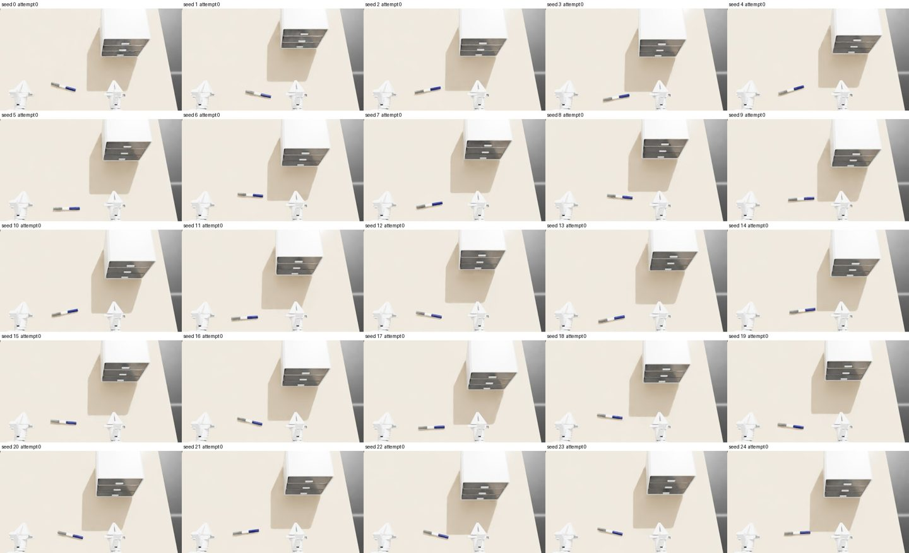

# 04 设计场景

以 [scene-000000](../../asset_sources/scenes/scene-000000/) 为例：X1Pro 站在桌前，桌上一个三抽屉柜和一支笔。场景是一个 Python 模块，写明桌子、机器人、物体，以及每个 seed 怎样随机摆放；框架负责检查初态并把它放进 Isaac Lab。规范见[场景与专家轨迹规范](../designs/scenes.md)。

**输入：** 已构建的资产 `assets/objects/cabinet/000000`、`assets/objects/pen/000002`（第二章）与机器人 `assets/robots/x1pro`（第三章）。

**输出：** `asset_sources/scenes/scene-000000/scene.py`；初态检查结果 `initial.json` 与 25 个初态的拼图 `grid.jpg`（缩小后存为场景目录的 `initial_states.jpg`）。

环境同第三章：

```bash
uv sync --locked --extra sim --extra robots
export ISAAC_PYTHON=$PWD/.venv/bin/python
```

## 1. 场景源码

[scene.py](../../asset_sources/scenes/scene-000000/scene.py) 的内容：

| 名称 | 本例 |
| --- | --- |
| `TABLE` | 1.36 × 1.02 m，高 0.755 m |
| `ROBOT` | `robots/x1pro`，底盘在桌子 −Y 边外 (−0.03, −0.80)，朝 +Y；躯干升 0.40 m，头低 0.30 rad，双臂零位（折叠） |
| `OBJECTS` | `cabinet`：`objects/cabinet/000000`；`pen`：`objects/pen/000002` |
| `VIEWS` | 录像用的 `wide`、`close` 与看摆放用的俯视 `top` 三个固定视角 |
| `initialize(layout)` | 抽屉柜原点在 (0.30, 0.06) ± 5 cm，抽屉朝向机器人；笔原点在 (−0.04, −0.36) ± 5 cm，偏航 ±0.3 rad，在机器人右手前方、抽屉拉出范围之外 |

```python
def initialize(layout):
    layout.place('cabinet', region=((.25, .01), (.35, .11)))
    layout.place('pen', region=((-.09, -.41), (.01, -.31)), yaw=(-.3, .3))
```

`place` 在区域内均匀采样原点，按资产碰撞几何算出稳定朝向与贴住桌面的高度，与已放物体穿透就重采。需要更细的控制时，直接用 `set_pose`、`set_joint` 和几何查询（`resting_pose`、`penetration`、`geometry`）自己写，例如先放一个碗，再把另一个碗放进去。

## 2. 检查初态

```bash
"$ISAAC_PYTHON" scripts/scenes/check_scene.py scene-000000 --output outputs/scenes/scene-000000/check --gpu 0
```

对 seed 0–24 各做一次与生成轨迹时相同的初始化：

1. 运行 `initialize`；
2. 检查物体之间、物体与桌面之间无穿透（允许接触）；
3. 复位后静置 1 s，物体相对支撑的移动不超过 3 mm、2°，抽屉不滑动，机器人不碰任何东西。

不通过就换子 seed 重来。

本例结果：25 个 seed 全部第一次通过；静置时笔最多移动 0.38 mm、转动 0.18°，抽屉柜不动。每个 seed 约 2.3 s，含启动共约 3 分钟。拼图 `grid.jpg` 用场景的 `top` 视角（`--view` 可换），用于人工查看摆放是否合理、是否有足够变化：



最初笔按资产原始朝向平放，有一条棱朝下，静置时会滚 7.5° 到相邻的面上，检查因此不通过。现在 `place` 先取离给定朝向最近的稳定朝向（由碰撞凸包算出），静置移动降到 0.4 mm、0.2°。

`initial.json` 记录每个 seed 的每次尝试：问题、静置时各物体的移动量、机器人接触。
